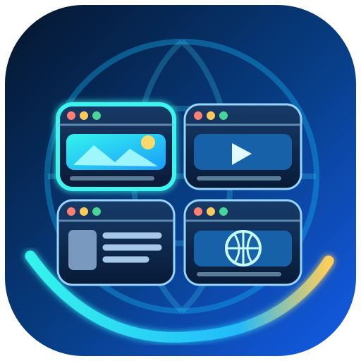
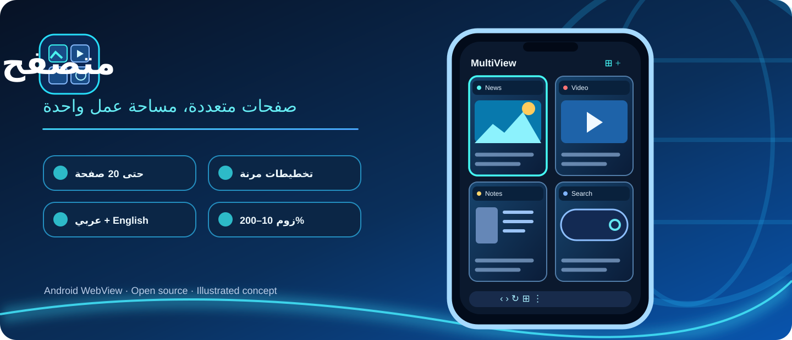
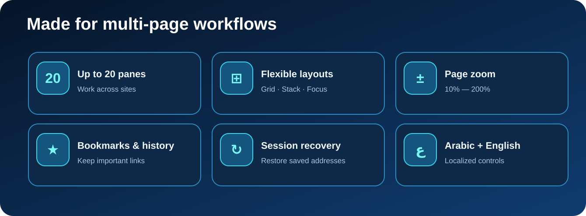
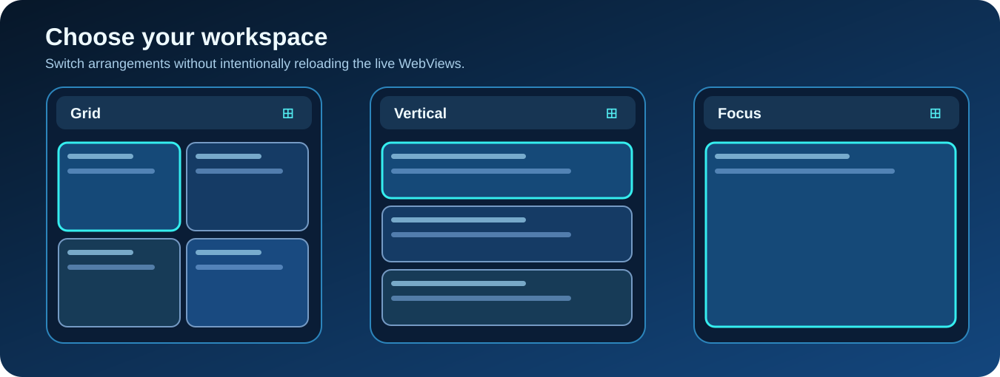

<div dir="rtl">
<p align="center"></p>
<h1 align="center">متصفح العرض المتعدد | MultiView Browser</h1>
<p align="center"><strong>متصفح أندرويد واحد، وصفحات ويب متعددة جنباً إلى جنب.</strong></p>
<p align="center"><a href="README.md">🇬🇧 English</a> &nbsp;|&nbsp; <a href="README.ar.md">🇮🇶 العربية</a></p>
<p align="center"></p>

> **إصدار تجريبي من سلسلة 0.4.x.** اجتاز المشروع اختبارات البناء الآلي، لكن بعض المزايا تحتاج اختباراً على الهاتف الحقيقي. الصور هنا **تصاميم توضيحية وليست لقطات فعلية من التطبيق**.

<h2>تحميل التطبيق</h2>
<p><a href="https://github.com/alwansan/MultiView-Browser/releases/download/preview-latest/app-debug.apk"><strong>تنزيل APK التجريبي مباشرة</strong></a> · <a href="https://github.com/alwansan/MultiView-Browser/releases/tag/preview-latest">صفحة الإصدارات</a> · <a href="https://github.com/alwansan/MultiView-Browser/actions/workflows/android.yml">نتائج البناء</a></p>

إذا رفض أندرويد تثبيت تحديث بسبب اختلاف توقيع نسخة Debug، احفظ روابطك المهمة قبل إزالة النسخة القديمة. ويمكن تجهيز توقيع ثابت وفق <a href="docs/SIGNING_SETUP_AR.md">دليل التوقيع الآمن</a>.

<h2>المميزات</h2>
<p align="center"></p>

<ul>
<li><strong>من صفحة واحدة إلى ٢٠ صفحة:</strong> لكل صفحة عنوان مستقل وأزرار تنقل وتحكم.</li>
<li><strong>تخطيطات متعددة:</strong> الشبكة الملائمة، الشبكة القابلة للتمرير، الصفحات العمودية، الشريط الأفقي، وعرض التركيز.</li>
<li><strong>الزوم:</strong> من ١٠٪ إلى ٢٠٠٪ بخطوة ١٠٪، مع اختيار نسبة لصفحة واحدة أو لجميع الصفحات وحفظها.</li>
<li><strong>فتح الروابط المتعددة:</strong> لصق قائمة روابط وتوزيعها على الصفحات، مع قوائم محفوظة والمفضلة وسجل التصفح.</li>
<li><strong>العربية والإنجليزية:</strong> قوائم مترجمة ووضع داكن تجريبي لمحتوى المواقع.</li>
<li><strong>الاستعادة:</strong> حفظ روابط الصفحات وإعداداتها وتقليل التحميل الجماعي بعد إعادة تشغيل عملية التطبيق.</li>
<li><strong>أدوات إضافية:</strong> تنزيل ملفات، رفع ملفات، تصوير الصفحة، وضع سطح المكتب، البحث داخل الصفحة، وزر إعادة تحميل جميع الصفحات والتنظيف الاختياري للملفات المؤقتة والسجل والقوائم المحفوظة.</li>
</ul>

<h2>أنماط العرض</h2>
<p align="center"></p>
<p><em>هذه رسومات توضيحية للمنتج، وليست صوراً مأخوذة من تشغيل التطبيق الحقيقي.</em></p>

<h2>ملاحظة مهمة عن العمل بالخلفية</h2>
<p>قد ينهي أندرويد التطبيق أو محرك WebView عند ضغط الذاكرة. <strong>لا يمكن ضمان بقاء ٢٠ صفحة حيّة إلى الأبد أو منع كل إعادة تحميل.</strong> توجد خدمة حماية جلسة اختيارية مع إشعار ظاهر، لكنها لا تمنع جميع حالات قتل العملية. ولا يمكن استعادة بعض حالات JavaScript أو النصوص غير المرسلة بعد موت العملية. الصفحات العادية تتشارك ملفات الارتباط.</p>

<h2>بناء التطبيق</h2>
<p>يتطلب Java 17 وAndroid SDK 35 وGradle 8.10.2:</p>
</div>

```sh
gradle --no-daemon :app:assembleDebug
```

<div dir="rtl">
<h2>ملفات المشروع</h2>
<ul>
<li><a href="docs/README.md">فهرس التوثيق</a> و<a href="CHANGELOG.md">سجل التغييرات</a>.</li>
<li><a href="docs/PLAN_AR.md">خطة التطوير</a> و<a href="docs/TEST_LOG.md">سجل الاختبارات</a>.</li>
<li><a href="docs/DEVICE_TEST_AR.md">اختبارات الهاتف</a> و<a href="docs/BACKGROUND_RELIABILITY_AR.md">دليل حماية الجلسات</a>.</li>
<li><a href="docs/SIGNING_SETUP_AR.md">إعداد توقيع ثابت لتحديث APK</a>.</li>
<li><a href="PROJECT_MEMORY.md">ذاكرة المشروع</a>، <a href="AGENTS.md">تعليمات الوكيل</a>، <a href="RESTORE_AR.md">رسالة الاستعادة</a>.</li>
<li><a href="assets/brand/README.md">دليل الأيقونات والرسومات</a>.</li>
</ul>

<h2>الخصوصية والاستقلالية</h2>
<p>هذا مشروع مستقل، ولا يتبع المواقع المفتوحة داخله أو التطبيق المرجعي. لا توجد ملفات APK تجارية منسوخة ضمن المستودع. لا تنشر كلمات المرور أو ملفات تعريف الارتباط أو روابط الجلسات الخاصة داخل Issues أو سجلات العمل.</p>

<p align="center"><a href="README.md">Read in English</a> · صنع لتصفح عدة صفحات بسهولة.</p>
</div>
