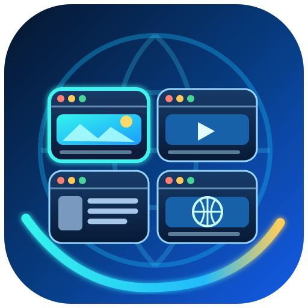
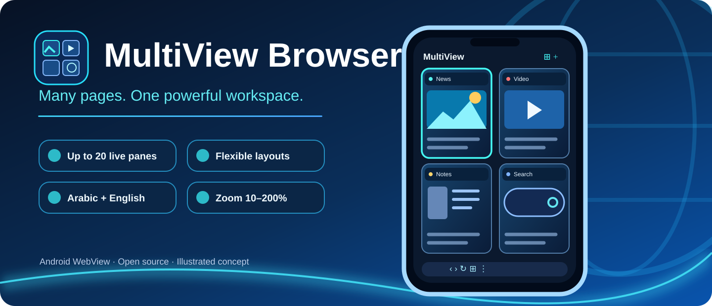
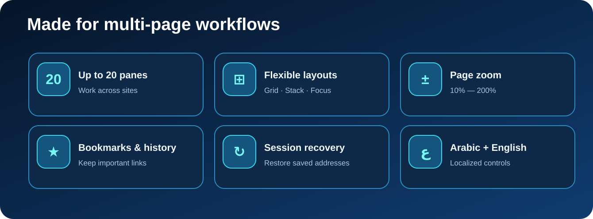
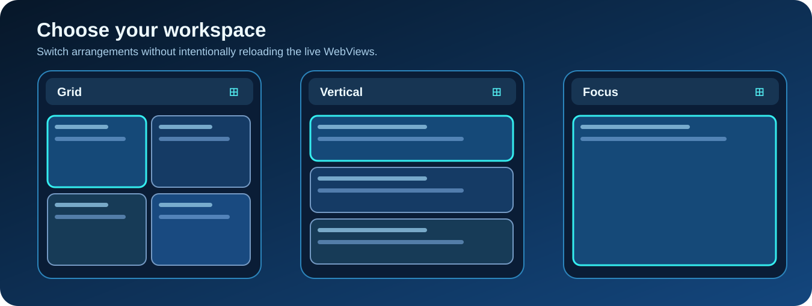

<p align="center"></p>
<h1 align="center">MultiView Browser</h1>
<p align="center"><strong>One Android browser. Multiple pages, side by side.</strong></p>
<p align="center"><a href="README.md">🇬🇧 English</a> &nbsp;|&nbsp; <a href="README.ar.md">🇮🇶 العربية</a></p>
<p align="center">
<a href="https://github.com/alwansan/MultiView-Browser/actions/workflows/android.yml"></a>
<a href="https://github.com/alwansan/MultiView-Browser/releases/tag/preview-latest"></a>


</p>
<p align="center"></p>

> **Preview • 0.4.x series.** Built with Android WebView and tested by CI. Some features still require real-device verification. The artwork on this page is **concept art, not screenshots of a tested build**.

## Get the app

[**Download experimental APK**](https://github.com/alwansan/MultiView-Browser/releases/download/preview-latest/app-debug.apk) · [**Releases**](https://github.com/alwansan/MultiView-Browser/releases/tag/preview-latest) · [**Build history**](https://github.com/alwansan/MultiView-Browser/actions/workflows/android.yml)

This rolling preview is a developer build. If Android rejects an update due to a different debug signing certificate, export important URLs before uninstalling. [Set up a stable signing key (Arabic)](docs/SIGNING_SETUP_AR.md).

## Explore the browser

<p align="center"></p>

- **1–20 WebViews** within a single Android activity, each with its own URL, navigation and controls.
- **Layouts:** Fit Grid, Scroll Grid, Vertical Stack, Horizontal Strip and Single Focus.
- **Page zoom:** 10%–200% in 10% increments; apply to one pane or save and apply to all.
- **Link workspace:** paste multiple URLs, reuse saved link lists, browse bookmarks and history.
- **Arabic + English interface,** plus optional experimental darkening for website content.
- **Session resilience:** restore URLs and settings, defer loading of offscreen panes on cold startup, and opt into a visible ongoing background service.
- **Browser utilities:** downloads, file chooser, screenshots, desktop user-agent, in-page search, manual reload-all and **selective privacy cleanup**.

### Choose a layout

<p align="center"></p>

*Illustrations are for communicating the concept. For actual UI verification, use the APK and [device test guide](docs/DEVICE_TEST_AR.md).*

## Important limits

Android can terminate an app or its WebView renderers when memory is constrained. **No ordinary Android application can promise that 20 live pages will never be reloaded.** The opt-in foreground service can improve process importance but cannot make the app immortal. A killed JavaScript context, unsent web form or in-memory page state may not be recoverable. The website-dark option is experimental; normal panes share the WebView cookie profile.

## Build from source

Requires JDK 17, Android SDK Platform 35 and Gradle 8.10.2:

```sh
gradle --no-daemon :app:assembleDebug
```

CI builds and publishes the preview APK from `main` via [Android workflow](.github/workflows/android.yml). A stable release signing key must be held privately using GitHub Actions secrets; never commit a keystore.

## Project documents

| Topic | Documentation |
|---|---|
| Documentation index | [All project docs](docs/README.md) · [Changelog](CHANGELOG.md) |
| Project roadmap | [Plan (Arabic)](docs/PLAN_AR.md) |
| Testing | [Device checklist](docs/DEVICE_TEST_AR.md) · [Test log](docs/TEST_LOG.md) |
| Background stability | [Background reliability (Arabic)](docs/BACKGROUND_RELIABILITY_AR.md) |
| Signing | [Safe signing setup](docs/SIGNING_SETUP_AR.md) |
| Engineering continuity | [Memory](PROJECT_MEMORY.md) · [Agent guide](AGENTS.md) · [Restoration prompt](RESTORE_AR.md) |
| Design assets | [Brand assets](assets/brand/README.md) |

## Independence and privacy

MultiView Browser is independently implemented; it is not affiliated with third-party websites or the reference browser. Proprietary APK content is **not** included. Do not publish login credentials, cookies, private URLs or personal chat content in issues or logs.

---

<p align="center"><a href="README.ar.md">اقرأ هذه الصفحة بالعربية</a> · Made for focused multi-page browsing.</p>
